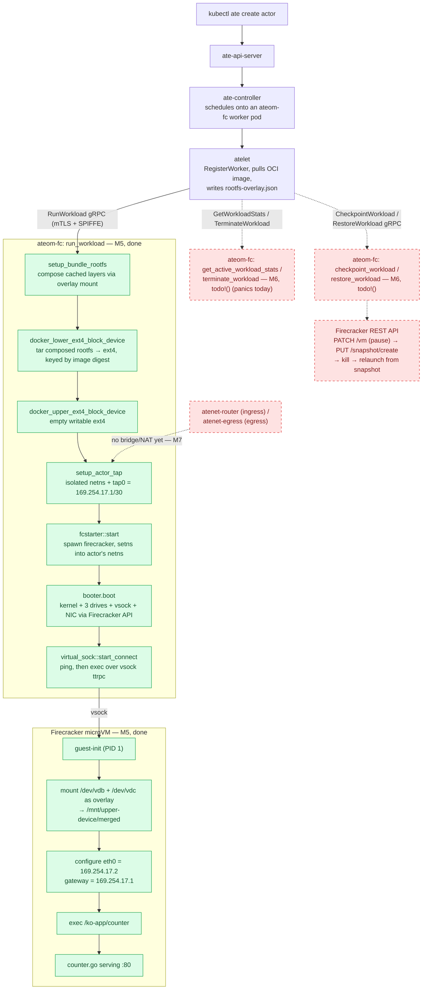

# ateom-firecracker

[](https://opensource.org/licenses/Apache-2.0)

A from-scratch Rust reimplementation of a Firecracker-microVM sandbox
backend for [Agent Substrate](https://github.com/agent-substrate/substrate),
built as a personal proof-of-concept alongside the project's existing
`ateom-gvisor` and `ateom-microvm` backends. Not yet integrated with
Substrate — exercised standalone for now.

> **⚠️ Research project / proof-of-concept — not for production use.**
> This is a personal POC, built to explore whether a from-scratch Firecracker
> backend is viable for Agent Substrate. It has not been security-reviewed,
> is missing basic production concerns (see "Out of scope" in
> [`docs/dev/ateom-firecracker-milestones.md`](docs/dev/ateom-firecracker-milestones.md):
> jailer/seccomp hardening, CSI/volumes, observability, error-path robustness,
> etc.), and several pieces of networking setup used only for local
> development (see `scripts/`) are explicitly disposable, not hardened. Use
> at your own risk; do not run untrusted workloads through this code.

## Architecture

Three things sit nested inside one worker pod: the long-running
`ateom-firecracker` daemon, the guest-init binary it talks to, and the
actor's own container process.


Solid grey arrows are plain process mechanics (fork/exec, the REST API). The
dashed teal line is the vsock control channel — it leaves `ateom-firecracker`,
runs through the `firecracker` process, crosses the hardware-trapped guest
boundary, and lands on `ateom-firecracker-init`, which only then execs the
actor's own process.

### What ateom-firecracker actually does

**Process lifecycle**
- Is the worker pod's own entrypoint — the first thing the pod runs.
- Forks + execs `firecracker` per active actor, and stays its parent for its whole life.
- Reaps an orphaned Firecracker child if it's ever reparented — the same duty a real PID 1 has, one level down.
- On `SIGTERM`: stops accepting new workloads, lets in-flight RPCs finish, then drains.

**Driving the VMM**
- Configures boot-source, drives, vsock and machine-config over Firecracker's REST API.
- Drives pause → snapshot → shutdown for checkpoint (M6, not yet built).
- Relaunches a fresh process and restores it from a snapshot to resume (M6, not yet built).

**Talking to the guest**
- Runs the host side of the vsock channel to `ateom-firecracker-init`: run, exec, stats, shutdown.
- Forwards the actor's stdout/stderr back to the pod's own stdout, labeled.

**Control-plane integration**
- Reports this worker's capacity (sandbox class, slot count) on startup (M5, done).
- Serves `RunWorkload` over gRPC end to end — OCI image composition, boot,
  exec inside the guest (M5, done). `CheckpointWorkload` /
  `RestoreWorkload` / `GetWorkloadStats` / `TerminateWorkload` are still
  `todo!()` stubs (M6, not yet built).
- M5 (`ateompb.AteomServer` integration, real end-to-end `RunWorkload`)
  shipped; M6 (checkpoint/restore/stats/terminate) and M7 (egress/ingress)
  are next — see "Status" below.

### What's actually running, host to guest

Neither channel crosses straight from host to guest — both pass through
`firecracker`, which is the only process with a door into the guest. vsock
has two distinct hops: a one-time boot-time call that tells firecracker to
create the vsock device (ends inside firecracker — the guest never sees this
call), and a separate runtime connection that actually carries ping/exec
through to guest-init. Networking works the same way: `ateom-fc` hands
firecracker a tap device's name over `PUT /network-interfaces`, firecracker
opens the tap and presents it as `eth0`, and `guest-init` then configures
that `eth0` itself (address, link-up, default route) via raw ioctls. The
hardware trap itself sits only between firecracker and the guest kernel it
runs, not between `ateom-fc` and firecracker, which talk over an ordinary
REST/socket call.


## Layout

- `ateom-fc/` — the host daemon (async, tokio). Starts Firecracker, drives its
  REST API (boot-source, drives, vsock, machine-config, start), and talks to
  the guest over vsock.
- `guest-init/` — the guest's PID 1 (sync). Mounts the OCI image + per-actor
  overlay, runs a ttrpc server over vsock, execs the actor's process.
- `ateomfcpb/` — the shared proto crate, with dual async/sync codegen so the
  same `.proto` serves both sides.
- `scripts/` — throwaway dev tooling, not part of the real backend (e.g.
  `mac-reachability.sh`, which bridges a running actor's network namespace
  out to the Mac host for manual testing — disposable test scaffolding,
  not something that survives Substrate integration).

## Status

The diagram below is the full intended request path. Solid green boxes are
confirmed working (see "Proof" below); dashed red boxes are the remaining
`todo!()` stubs and the missing networking bridge, picked up in M6 and M7.
Kept in sync with the same diagram in
[`docs/dev/ateom-firecracker-milestones.md`](docs/dev/ateom-firecracker-milestones.md#end-to-end-flow-m5-done-full-path-incl-m6m7),
which also has the per-gap explanations.



| Milestone | What it proved | Status |
|---|---|---|
| M1 | Boot + vsock liveness ping | done |
| M2 | Single rootfs, blocking exec | done (superseded by M3) |
| M3 | OCI image → per-actor overlay rootfs, fire-and-forget exec | done |
| M4 | Tap networking — host + guest addressing, Firecracker wiring, verified reachable from the Mac host | done |
| M5 | Real `ateompb.AteomServer`: a `RunWorkload` gRPC call from unmodified Substrate boots a Firecracker microVM running the workload image, end to end | done |
| M6 | Remaining `AteomServer` functionality — checkpoint/restore (Firecracker pause/snapshot/restore), workload stats, terminate, multi-container actors | not yet built |
| M7 | Egress and ingress — bridge/NAT so `atenet-router`/`atenet-egress` reach a Firecracker-backed actor the normal way | not yet built |

Full milestone plan: [`docs/dev/ateom-firecracker-milestones.md`](docs/dev/ateom-firecracker-milestones.md).
Per-milestone notes and lessons learned: [`docs/dev/`](docs/dev/).

### Proof: the real counter workload running end to end (M5)

A `RunWorkload` gRPC call from unmodified Substrate, composing the OCI
image, booting a Firecracker microVM, and executing the `counter.go`
binary inside it — not a smoke test against the baked-in test image.

`ateom-fc`'s own stdout, from a run on 2026-10-27, reading the logs:

```
firecracker stdout [PID 1] Launched echo with PID: 105
command executed successfully
firecracker stdout {"time":"2026-10-27T12:52:01.951666417Z","level":"INFO","msg":"Starting counter server on port 80"}
firecracker stdout [   12.068158] random: crng init done
firecracker stdout {"time":"2026-10-27T12:52:10.114159046Z","level":"INFO","msg":"Wrote content to random file","fshash":"eNIw19eTjhKuRgUS9YHI5nqh7gxJdsp6gJ67i5Zna5E"}
firecracker stdout {"time":"2026-10-27T12:52:10.126680754Z","level":"INFO","msg":"Readyz now reports OK"}
firecracker stdout {"time":"2026-10-27T12:52:10.146733504Z","level":"INFO","msg":"Count","count":0,"fshash":"eNIw19eTjhKuRgUS9YHI5nqh7gxJdsp6gJ67i5Zna5E"}
```

From an earlier run, an HTTP response was `curl`-ed from the node by
entering the actor's own network namespace (see
[`docs/dev/ateom-firecracker-milestones.md`](docs/dev/ateom-firecracker-milestones.md)
for the exact command and the remaining ingress gap this works around):

```
hello from: 169.254.17.2 | preserved memory count: 1 | preserved file counter: -1 | preserved rootfs counter: 1
```

## Code Claude wrote directly

The default workflow on this project is: the author writes the application
code, Claude reviews, researches Substrate's real contracts, and verifies
builds. A few pieces were written directly by Claude instead, each under an
explicit, scoped go-ahead — listed here since they haven't had the same
review as the rest of the codebase.

- **mTLS/`RegisterWorker` client** (`ateom-fc/src/atlet_client.rs`) — the
  whole file. Judged out of depth for a first pass (hand-built `rustls`
  `ServerCertVerifier`, SPIFFE identity checks, a bespoke Substrate X.509
  extension, `tonic-tls`'s reconnect-safe connector). Flagged in the file
  itself as not yet reviewed line by line.
- **Real gRPC server against Substrate's actual wire contract**
  (`ateom-fc/src/ateom.rs`, `ateom-fc/src/ateom_server.rs`) — vendored the
  real `ateom.proto` and rewrote the server against it, replacing an
  earlier invented service that silently never matched the real contract.
- **OCI rootfs composition** (`ateom-fc/src/docker_ext4.rs`) — the
  `OverlaySpec` contract types and the `setup_bundle_rootfs` overlay-mount
  function, mirroring Substrate's real `internal/imagecache` design.
  Marked in the file itself as not yet reviewed line by line.
- **`run_workload`'s end-to-end wiring** (`ateom-fc/src/ateom_server.rs`) —
  driving rootfs composition, tap/netns setup, Firecracker boot, and the
  vsock exec from one request handler.

Everything else — `fcstarter.rs`, `booter/`, `tap.rs`, `virtual_sock.rs`,
all of `guest-init/` — was written by the project's author; Claude's role
there was review, research, and build verification.

## Dev environment

Developed and tested inside a Lima VM with nested virtualization enabled
(`vmType: vz`, requires Apple Silicon + macOS 15+), with `/dev/kvm` available
inside the guest. See `docs/dev/` for milestone-specific setup notes.

## Reference notes

`docs/*.md` has working notes on the specific Firecracker REST API calls this
project drives: [`boot-source`](docs/boot-source.md), [`drives`](docs/drives.md),
[`machine-config`](docs/machine-config.md), [`vsock`](docs/vsock.md),
[`actions`](docs/actions.md), and guest-side [`mount-virtual-fs`](docs/mount-virtual-fs.md).

## License

Apache License 2.0 — see [`LICENSE`](LICENSE).
