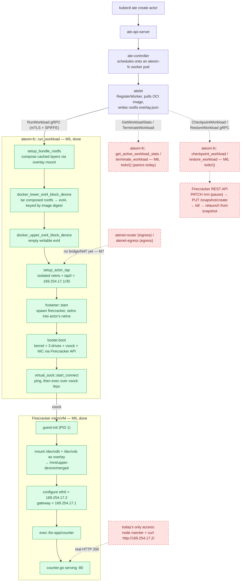

# ateom-firecracker: POC Milestones

This document tracks the milestone plan for `ateom-firecracker`, a third
sandbox backend for Agent Substrate (alongside `cmd/ateom-gvisor` and
`cmd/ateom-microvm`), using [Firecracker](https://github.com/firecracker-microvm/firecracker)
as the VMM instead of Cloud Hypervisor.

This is a personal proof-of-concept effort, not yet an upstream contribution.
The goal is an end-to-end POC first; production concerns (security hardening,
CSI/volumes, observability, multi-arch asset builds, etc.) are deliberately
deferred until the POC proves the approach out. See "Out of scope" below.

## Key decisions

* **New `SandboxClassFirecracker`**, parallel to `gvisor`/`microvm`, rather than
  a variant under the existing `SandboxClassMicroVM`. Touches
  `pkg/api/v1alpha1/sandboxconfig_types.go`, the `ValidatingAdmissionPolicy` in
  `manifests/ate-install/sandboxconfig-validation.yaml`, and
  `cmd/atecontroller/internal/controllers/workerpool_apply.go`.
* **No Kata.** `ateom-microvm` uses Kata Containers' guest-agent model, which
  assumes virtio-fs for rootfs sharing — a device Firecracker does not
  implement by design. Rather than following Kata's Firecracker driver (which
  works around this with a devicemapper-backed block rootfs), `ateom-firecracker`
  owns a minimal custom guest-init and vsock protocol directly. Suspend/resume
  comes from Firecracker's own REST API (pause/snapshot/resume), the same
  pattern `internal/ch` already uses for Cloud Hypervisor, just VMM-specific.
* **Guest-init written in Go**, not Rust. Rust is a reasonable fit for a
  minimal guest PID 1 (smaller binary, lower baseline memory, faster runtime
  init), but Go was chosen for tooling consistency: one protobuf codegen
  pipeline shared between host and guest, free reuse of the repo's existing
  Go-only CI/lint tooling, and `CGO_ENABLED=0` already yields a static,
  libc-free binary without a second (musl) toolchain. Worth revisiting with
  real cold-boot/memory measurements if density targets later demand it.

## End-to-end flow (M5 done; full path incl. M6/M7)

The diagram below is the full intended path. Solid green boxes are
confirmed — on 2026-10-27, by `curl`-ing the running workload (see the M5
closing note). Dashed red boxes are the remaining `todo!()` stubs and the
missing networking bridge, picked up in M6 and M7. Everything left of
`ateom-fc` is unmodified Substrate; everything inside the shaded boxes is
this project's code.

**M6 gaps shown above:** `CheckpointWorkload`/`RestoreWorkload` are
`todo!()`, so there's no driver yet for Firecracker's own pause/snapshot/
restore REST API. `GetWorkloadStats`/`GetActiveWorkloadStats` are also
`todo!()`, which **panics** (not a clean gRPC error) every time atelet's
background stats poller calls it (~every 50s). `TerminateWorkload` being
`todo!()` is likely why an actor can't leave `RUNNING` cleanly today.

**M7 gap shown above:** the `VERIFY` step only works because you can
`nsenter` into the node and reach `169.254.17.2` directly. There is no
bridge/NAT from `tap0` back to the pod's own primary network namespace, so
the normal Substrate flow — port-forwarding `atenet-router` and `curl`-ing
with an `ate-target-actor` header, the same way
[`demos/counter/README.md`](../../demos/counter/README.md) describes — does
not yet reach a Firecracker-backed actor.

## Milestones

### M0 — Dev environment (done)

A Lima VM (`fcvm`) with nested virtualization enabled (`vmType: vz`,
`nestedVirtualization: true`; requires Apple Silicon M3+ and macOS 15+),
`/dev/kvm` confirmed working inside the guest, and a hand-built kernel +
rootfs proven to boot under plain Firecracker.

### M1 — Bare boot + liveness ping

A throwaway Go harness launches `firecracker --api-sock`, configures
boot-source/drives/vsock via the REST API (not the CLI `--config-file` form),
boots a minimal Go guest-init as `/init` in a tiny ext4 image, and the
guest-init sends one "I'm alive" message back over vsock.

**Done when:** the harness observes that message and exits cleanly. No
workload, no OCI image, no checkpoint.

### M2 — Run a real process, relay output

Guest-init execs a hardcoded command and streams its stdout/stderr back over
vsock to the host harness.

**Done when:** `firecracker` boots, runs e.g. `echo hello from the guest`, and
the host process prints it.

**Zombie reaping, deliberately deferred (2026-10-20):** `guest-init` (PID 1)
only `wait()`s on the one command it directly spawns — it does not run a
general reap-any-child loop. In principle PID 1 is responsible for *any*
process reparented to it (if the spawned workload itself forks subprocesses
and exits before they do, those get reparented to `guest-init` by the
kernel, one image per VM or not). Decided to accept this risk for the POC
rather than build it now: one controlled workload per VM, known shape.
Revisit if the scope moves toward less-controlled/arbitrary workloads.

### M3 — OCI image → per-actor rootfs

Smaller than it first looks: `internal/imagecache` already does the
expensive, backend-agnostic work (pulling images, node-local layer caching
and dedup, composing a per-actor rootfs via a host-side overlay mount via
`imagecache.SetupBundleRootfs`) and is already shared by both
`ateom-gvisor` and `ateom-microvm` — none of that needs reinventing.

What's left, per `internal/imagecache/README.md`'s own split, is the one
part that's explicitly backend-specific: getting that already-composed host
directory in front of the workload ("runsc's gofer for gVisor, virtiofsd for
the micro-VM" — no Firecracker row exists yet). `internal/rootfs` is just
that bridge: host-composed directory → something Firecracker can attach as
a drive. guest-init execs the image's actual entrypoint instead of a
hardcoded command.

Open design question to resolve here, not before: tar the already-merged
directory into one block image per actor (simple, but loses the
shared-lower/cheap-upper-only-snapshot properties `ateom-microvm` gets from
virtio-fs), vs. doing our own lower/upper split as two block devices and
letting the guest mount the overlay itself (more work, preserves those
properties).

**Done when:** an arbitrary small OCI image (e.g. a single static Go test
binary as its own image) boots and runs unmodified.

### M4 — Networking

A tap device plus host-side NAT/bridge so the actor process can send and
receive network traffic, mirroring `internal/ateomnet`'s pattern for the other
backends.

**Done when:** a workload inside the microVM can serve one HTTP request from
the host.

### M5 — Real `ateompb.AteomServer` (done)

Vendor Substrate's `internal/proto/ateompb/ateom.proto` (the `Ateom` gRPC
service: `RunWorkload`/`CheckpointWorkload`/`RestoreWorkload`/
`GetWorkloadStats`) directly into this repo and generate a Rust server for it
with `tonic-build`/`prost-build` — no separate crate, no cross-repo Go
package reuse; it's a self-contained Rust implementation of the same wire
contract. Turn the harness into the real `ateom-fc` server: implement the
RPCs end to end (driving the existing boot/rootfs/networking code already
built in M1–M4) plus shutdown-draining.

**Done when:** a real workload, submitted as a `RunWorkload` gRPC call, runs
successfully on the Lima `kind` cluster — not just a standalone `grpcurl`
smoke test.

**`RegisterWorker`/mTLS client written by Claude (2026-10-26):** the
scheduler reports `0/0` capacity for any worker that never calls `atelet`'s
`RegisterWorker` RPC, so this had to be implemented before an actor could be
placed at all (`atlet_client.rs`). Out of depth for a first pass, so Claude
wrote this file end to end rather than just reviewing it, unlike the rest of
the codebase. Flagged in the file itself
(`// TODO: for sgavulla, review this code and rewrite it`). Revisit once
there's time to build a full understanding of the mTLS/rustls machinery
here, rather than trusting it as a black box.

Why this one piece is genuinely more involved than typical plumbing:

* **No library covers it.** `rustls` requires hand-building a custom
  `ServerCertVerifier` (4 trait methods) for anything beyond the stock
  hostname-based checks. The one existing Rust SPIFFE+rustls crate
  (`spiffe-rustls`) looked like a fit but turned out to require a live SPIRE
  agent Workload API connection for its certs/bundles; this cluster delivers
  certs a completely different way (kubelet `podCertificate` +
  `clusterTrustBundle` projected volumes, no SPIRE agent at all), so it
  doesn't apply here. Confirmed by reading the crate's own source/README,
  not assumed.
* **Atelet's cert has no hostname to check against.** The standard
  verifier always matches the peer cert against a DNS/IP server name; atelet's
  cert only has a SPIFFE URI SAN, so that path had to be replaced with manual
  chain/EKU validation (`rustls-webpki`'s `verify_for_usage`, with no
  hostname argument) plus an explicit SPIFFE-ID string check written by hand.
* **A Substrate-specific identity check on top of that.** Beyond SPIFFE
  identity, atelet must also be proven to be running on *this exact node* —
  done by reading a proprietary X.509 extension (OID
  `1.3.6.1.4.1.11129.2.12.1`, a raw JSON blob, not ASN.1) that no general
  X.509/TLS library knows how to interpret; this is bespoke to Substrate
  (`internal/substratex509`) and has to be hand-parsed either way, same as
  the Go reference does.
* **The connection has to be reconnect-safe.** `tonic`'s `Channel` expects
  to be able to redial on a dropped connection; a first pass that pre-built
  one TLS stream and handed it over as a single-use connector panicked the
  moment the connection actually broke. Fixed by switching to `tonic-tls`'s
  connector abstraction, which redials and re-handshakes fresh each time —
  but that's a non-obvious failure mode to hit and diagnose on a first
  attempt.

**Proto drift silently broke `RunWorkload` until diagnosed (2026-10-26):**
the vendored `proto/ateworker.proto` (`package ateworker; service Worker`)
did not match the real wire contract atelet dials (`package ateom; service
Ateom`, from `internal/proto/ateompb/ateom.proto`). Two gRPC services with
the same method names but different package/service identifiers don't
share a wire path, so tonic's server returned `Unimplemented` for every
`RunWorkload` call *without ever invoking the handler* — no log line
pointed at the real cause, which is why this took a full session to pin
down, and only surfaced once the sandbox-assets fix above let a call reach
the wire at all.

Root cause, confirmed from git history rather than guessed: the vendored
proto was copied correctly from upstream Substrate at the time it was
vendored — `origin/main` had already renamed `ateompb/ateom.proto` →
`ateworkerpb/ateworker.proto` (`#2254 rename ateom -> ateworker`). The
mismatch was on the other side: this repo's local Substrate checkout
(`~/code/go/src/substrate`, `main`) was 345 commits behind `origin/main`,
so the actual kind cluster under test was still running the pre-rename
`ateom`/`Ateom` service. Re-vendoring "the latest" from upstream would have
made this worse, not better.

Fixed by vendoring `proto/ateom.proto` from what's actually on disk in the
local Substrate checkout (not upstream) and reimplementing
`ateom_server.rs` against the real `ateom::ateom_server::Ateom` trait
instead of the invented `ateworker::worker_server::Worker`. Confirmed
working: a real `RunWorkloadRequest` — full atespace/actor identity,
container spec, resource limits, egress gateway, actor dirs — now reaches
`run_workload` for the first time in this project. The handler itself is
still a stub (returns an empty `RunWorkloadResponse` without booting
anything), so this proves the RPC path, not a running workload — driving
the real boot/rootfs/networking code (M1–M4) from this handler is still
open.

**Gap, not yet designed: multi-container actors (2026-10-26).**
`WorkloadSpec.containers` is `repeated` — an actor can genuinely run more
than one container, and this isn't a theoretical proto field: both
`ateom-gvisor` and `ateom-microvm` have real, exercised code looping over
`GetContainers()` throughout (per-container OCI bundles, wakeup probes,
checkpoint/restore, stats). No demo in this repo currently exercises more
than one container per actor, but the capability is live in the control
plane.

Both other backends get per-container isolation for free, from a component
they reuse rather than build: `runsc` natively runs multiple containers in
one sandbox (shared network namespace, separate mount/process namespace per
container), and `ateom-microvm` drives Kata's guest-agent, which implements
the same per-container isolation inside its guest. This project's own "No
Kata" decision (see "Key decisions" above) means `guest-init` has no
equivalent primitive and nothing resembling it has been designed — today it
mounts exactly one overlay and execs exactly one process directly into the
guest's own root mount namespace. Supporting more than one container would
mean building real per-container isolation inside `guest-init` (its own
mount namespace or `pivot_root` per container, at minimum) before this
container's own current work (reading `rootfs-overlay.json`, finalizing
layers, overlay-mounting) can even be assumed to generalize past the
single-container counter demo. Picking `spec.containers[0]` and ignoring
the rest is the current, explicit POC shortcut.

**Deferred (nice-to-have, not needed for this POC): schema sync tooling.**
For now, `ateom.proto` is vendored in as a plain copy of Substrate's
`internal/proto/ateompb/ateom.proto`, noted with the source commit hash it
was copied from — no registry, no submodule, manual resync if it drifts.
That's the right amount of process for a solo POC with one consumer, but
not for real upstream integration: once this moves toward an actual
contribution back to Substrate, reconsider a real single-source-of-truth
setup (a Buf Schema Registry, or a git submodule/subtree back to Substrate's
proto directory) so schema drift is caught automatically instead of by hand.

**M5 closing note — full E2E run confirmed (2026-10-27):** this milestone's
original "done when" (a `RunWorkload` gRPC call runs successfully on the
Lima `kind` cluster) is now met in full, beyond the RPC-reaches-the-handler
level the earlier note above describes. `run_workload` drives the entire
chain end to end — composes the OCI image via `setup_bundle_rootfs`, builds
the lower/upper ext4 drives, sets up the actor's tap/netns, boots a
Firecracker microVM, and execs the workload inside it (`/ko-app/counter`,
not a hardcoded test path). Verified with an HTTP request:
`nsenter`-ing into the actor's network namespace from the node and
`curl`-ing the guest directly returned `hello from: 169.254.17.2 |
preserved memory count: 1 | ...` from the `counter.go` server. See
"End-to-end flow" above for the full path this exercises.

This also retroactively satisfies the control-plane-wiring bar originally
planned as its own milestone below: reaching "runs successfully on the Lima
`kind` cluster" necessarily meant `kubectl ate create actor` scheduling a
real pod through the real `ate-controller`/`atelet`, with
`SandboxClassFirecracker` and worker registration already working — there
was no separate "wire it into the control plane" step left to do. That
milestone's slot is repurposed below (see M7).

Remaining known gaps, not yet closed by this milestone (picked up next):
`CheckpointWorkload`/`RestoreWorkload`/`GetWorkloadStats`/`TerminateWorkload`
are still `todo!()` stubs (the last of which is also why a `RUNNING` actor
currently can't be deleted without `--any-state` — see M6); multi-container
actors are undesigned (M5's own earlier note); and there is no path to this
actor from outside the node except the manual `nsenter` above (see M7).

### M6 — Remaining `AteomServer` functionality

Pick up everything M5 left as a stub now that the core boot path works
end to end:

* **`CheckpointWorkload`/`RestoreWorkload`**, backed by Firecracker's own
  REST API — pause (`PATCH /vm`), snapshot (`PUT /snapshot/create`),
  shutdown, and a restore path that relaunches `firecracker` from a
  snapshot directory. "Suspend" means pause + snapshot-to-disk, then
  **kill the whole Firecracker process** — not pause-and-hold it alive.
  "Resume" launches a **new** Firecracker process that loads the snapshot
  and continues execution transparently. Neither `guest-init` nor the
  workload has any awareness this happens — no special-casing needed in the
  guest at all; it's entirely a host/VMM-level concern.
* **`GetWorkloadStats`/`GetActiveWorkloadStats`** — currently `todo!()`,
  which panics (not a clean gRPC error) every time `atelet`'s background
  stats poller calls it (roughly every 50s). Needs a real implementation,
  even a minimal "no samples yet" response, to stop the recurring panic.
* **`TerminateWorkload`** — currently `todo!()`. Likely why an actor can't
  leave `RUNNING` cleanly today (`kubectl ate delete actor` needs
  `--any-state` to get around it, since normal teardown probably calls this
  RPC first).
* **Multi-container actors** — undesigned; `guest-init` only mounts one
  overlay and execs one process today (see M5's note on this).

**Done when:** a running stateful process (e.g. the counter) survives a full
suspend → process killed → restore → resume cycle with its in-memory state
intact, `GetWorkloadStats` no longer panics, and `TerminateWorkload` lets an
actor leave `RUNNING` without `--any-state`.

### M7 — Egress and ingress

Close the gap the "End-to-end flow" diagram above calls out: there is a tap
device and an isolated per-actor network namespace (`tap::setup_actor_tap`),
but nothing bridges it back to the pod's own primary network namespace —
mirroring `internal/ateomnet`'s pattern (NAT/bridge) for the other backends,
plus whatever's needed for `atenet-router` (ingress) and `atenet-egress`
(egress) to reach a Firecracker-backed actor the same way they reach a
gVisor/micro-VM one.

**Done when:** the normal Substrate flow — port-forwarding `atenet-router`
and `curl`-ing with an `ate-target-actor` header, exactly as
[`demos/counter/README.md`](../../demos/counter/README.md) already
describes for the other backends — reaches a Firecracker-backed actor,
with no manual `nsenter` required.

## Out of scope for the POC

Firecracker jailer/seccomp hardening, CSI/volume support, multi-arch asset
builds, golden-snapshot warmup optimization, real metrics/observability
wiring, error-path robustness and retries, snapshot-fidelity class
distinctions (rootfs vs. memory), CRD validation hardening, and anything from
`CONTRIBUTING.md`'s contribution process (CLA, discuss-first issue, PR
sizing) — all deferred until this moves toward an actual upstream
contribution.
